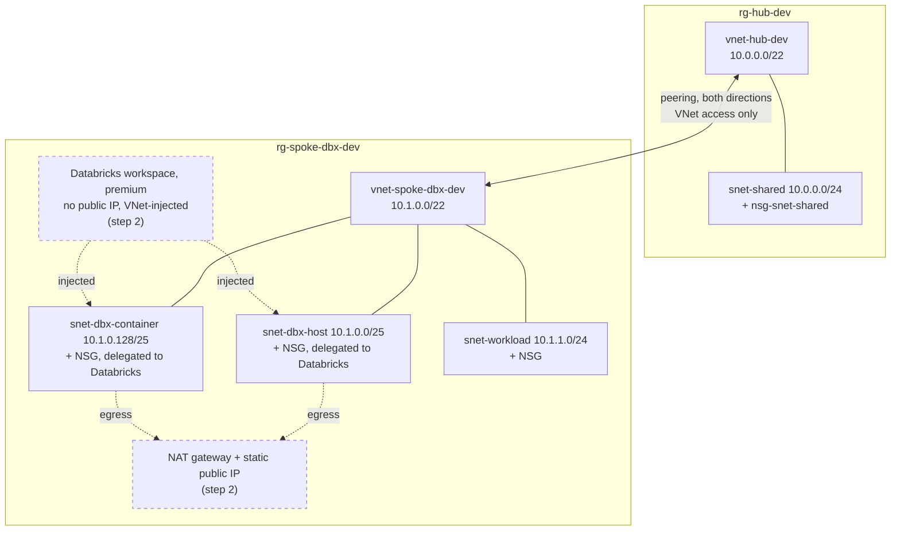

# azure-hub-spoke-databricks

[](https://github.com/tapanxd/azure-hub-spoke-databricks/actions/workflows/terraform-ci.yml)

I took a hub-spoke Azure network built by hand with `az` (standing in for the usual portal click-ops), brought it under Terraform with `import` blocks without recreating anything, then added a VNet-injected Databricks workspace on top. CI checks each step, and a small jq script fails the build if a plan would change, replace or delete something that was only supposed to be adopted.

## What I've actually run

On a real (Free Trial) subscription:

- Step 1 plan: `18 to import, 0 to add, 0 to change, 0 to destroy`. Applied, and the next plan was clean.
- Step 2 plan: `6 to add, 0 to change, 0 to destroy` (NAT gateway, its public IP, three associations, the workspace). Applied. The workspace took about four and a half minutes.
- The plan after step 2 was still clean, even though Databricks had added six rules to each delegated NSG.
- A cluster came up inside the spoke: one NIC in each Databricks subnet, no public IP. NAT gateway metrics showed outbound connections from it. I couldn't run a second cluster because the trial caps you at 4 vCPUs per region.

Everything except the Azure plan runs in CI on every push. The OIDC `plan` job is written but I haven't wired it to a subscription yet.

## Layout



The hub is nearly empty on purpose. In a real setup it would hold the firewall, gateways and DNS; here it's one subnet so the import story stays small.

All subnets have default outbound access turned off (new Azure VNets work that way now). With `no_public_ip = true` the cluster nodes have no other way out, which is why step 2 adds a NAT gateway.

```
modules/vnet                  VNet, subnets, one NSG per subnet, optional delegation
modules/peering               both peering directions
modules/databricks-workspace  NAT gateway (optional) + workspace
envs/dev                      wires the modules together; imports.tf has the import blocks
legacy/                       bootstrap.sh builds the "existing" network, teardown.sh removes it
scripts/assert-plan.sh        checks `terraform show -json` output
```

Hub and spoke use the same `vnet` module. They're the same shape, and another spoke is just one more module call.

## Running it

You need Terraform 1.9+ (CI pins 1.17.0), the az CLI, jq, make and tflint.

```bash
make check                       # offline: fmt, validate, tflint, terraform test, script tests

az login
legacy/bootstrap.sh              # DRY_RUN=1 to just print the az commands

cd envs/dev
cp terraform.tfvars.example terraform.tfvars    # set subscription_id
terraform init
terraform plan -out=tfplan
terraform show -json tfplan > plan.json && ../../scripts/assert-plan.sh plan.json import-only
terraform apply tfplan           # writes 18 resources to state, Azure doesn't change

# step 2: in terraform.tfvars set import_existing = false, enable_databricks = true
terraform plan -out=tfplan
terraform show -json tfplan > plan.json && ../../scripts/assert-plan.sh plan.json no-destroy
terraform apply tfplan
```

To clean up, run `terraform destroy`. It's the cleaner option once everything is in state. `legacy/teardown.sh` deletes both resource groups and works even without state; I used it, and had to delete the stale local state afterwards. Either way, Databricks removes its managed `databricks-rg-*` group on its own, and it took a while to disappear.

State is local. If more than one person is using this, use `envs/dev/backend.tf.example`.

## CI

Jobs: `fmt`, `validate` and `test` (both per module plus `envs/dev`), `tflint`, `scripts`, `security` (checkov), and `plan`. Only `plan` touches Azure.

The `terraform test` runs use `mock_provider "azurerm"`, so they never touch Azure. The one in `envs/dev` plans both migration steps against the mock and checks that step 1 is 18 imports. It also found a type error in the import maps that `terraform validate` let through.

checkov runs in soft-fail mode. It flags two things on the workspace, both deliberately out of scope for now: Private Link to the control plane (`CKV_AZURE_158`) and customer-managed keys for DBFS (`CKV2_AZURE_48`).

To turn the `plan` job on:

1. Create an app registration with federated credentials for `repo:<owner>/<repo>:ref:refs/heads/main` and `repo:<owner>/<repo>:pull_request`.
2. Give it Reader on the subscription.
3. Set the repo variable `AZURE_CLIENT_ID` and the secrets `AZURE_TENANT_ID` and `AZURE_SUBSCRIPTION_ID`.
4. Set `ENABLE_DATABRICKS=true` to assert step 2 instead of step 1.

Reader should be enough, because the job sets `ARM_RESOURCE_PROVIDER_REGISTRATIONS=none`; otherwise azurerm tries to register providers on startup. I've checked that setting with my own login, not with an actual Reader-only identity. With local state, the job can only ever check the import step from scratch, so it needs a real backend to be useful long term. It also fails once the environment is torn down, which is correct but annoying.

## Gotchas I hit

- `az network vnet subnet create --delegations` names the delegation `"0"` (by index). The config originally said `"databricks"`, which would have shown up as drift on every Databricks subnet. I found it by reading az's source, before the first real plan.
- Databricks writes its own rules into the delegated NSGs. Don't declare inline `security_rule`s on those NSGs, or Terraform will try to delete Databricks' rules on every apply. Leaving the attribute unset means Terraform ignores them.
- tflint's recommended preset does not require descriptions on variables and outputs. I turned on `terraform_documented_variables` / `_outputs` explicitly.
- Mock providers can't import. The env test needs an `override_resource` for every imported resource, with IDs realistic enough for azurerm's parsers.
- Pipe Terraform output through `-no-color` before grepping it. Otherwise `^Plan:` never matches, because the line starts with an ANSI code.

## Cost

While step 2 is deployed, the NAT gateway and public IP cost roughly $1/day plus data. Clusters bill as VMs plus DBUs while running. Everything else is free or close to it. Tear it down when you're done.

## Not done / next

- Azure Firewall in the hub with UDRs from the spoke, replacing the NAT (`create_nat_gateway = false` is already there for this).
- VPN/ExpressRoute gateway in the hub. The peering module already has the transit flags.
- Private Link and private DNS for the workspace, and CMK for DBFS. That would clear the checkov findings.
- Unity Catalog via the `databricks` provider.
- Remote state for the CI plan job. Tag standardisation as its own change, since doing it during the import would have broken the clean no-op plan.
- Only one env (`dev`), one spoke.

## Windows

Use WSL2 and keep the clone under `~/`, not `/mnt/c`. `.gitattributes` forces LF, because a CRLF in a `.sh` file breaks the shebang. Git Bash works for the scripts too; PowerShell doesn't.
