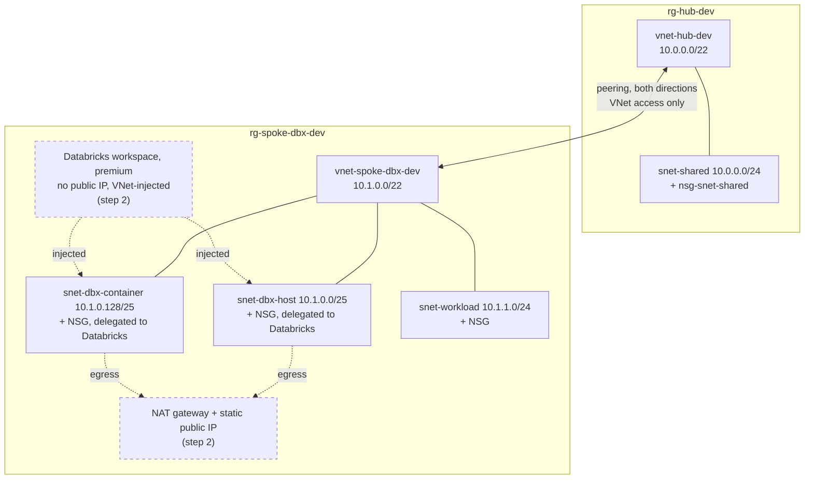

# Azure hub-spoke + Databricks, adopted into Terraform

[](https://github.com/tapanxd/azure-hub-spoke-databricks/actions/workflows/terraform-ci.yml)

This repo takes an Azure hub-spoke network that was built by hand (click-ops, simulated here with an `az` CLI script) and brings it under Terraform **without recreating anything**, using `import` blocks. On top of the adopted network it adds a **VNet-injected Azure Databricks workspace**. CI checks every change, and a plan assertion script fails the build if a plan would modify, replace or delete what was adopted.

## Status

| What | State |
|---|---|
| Modules, tests, lint, CI (no Azure credentials needed) | ✅ Green locally (`make check`) and in GitHub Actions |
| Step 1 import plan against a real subscription | ✅ `Plan: 18 to import, 0 to add, 0 to change, 0 to destroy.` |
| Step 1 apply | ✅ `18 imported, 0 added, 0 changed, 0 destroyed`; the follow-up plan shows no changes |
| Step 2 plan + apply (NAT gateway + Databricks workspace) | ✅ `6 to add, 0 to change, 0 to destroy`; `assert-plan.sh no-destroy` passes; the workspace was created in 4m23s |
| Plan after step 2 | ✅ No changes, although Databricks has added 6 rules to each delegated NSG |
| Cluster in the injected VNet | ✅ The node VM has one NIC in `snet-dbx-host` and one in `snet-dbx-container`, no public IP; NAT gateway metrics show outbound SNAT connections from it |
| Optional `plan` CI job (OIDC) | ⏳ Written, not yet wired to a subscription |

## Architecture



- **Hub**: shared services would live here (firewall, gateways, DNS). For now it only holds one subnet, to keep the scope tight.
- **Spoke**: the Databricks workload. Its host and container subnets are delegated to `Microsoft.Databricks/workspaces`, as VNet injection requires.
- **Private subnets**: every subnet has `default_outbound_access_enabled = false`, which matches Azure's default for new VNets. With secure cluster connectivity (no public IPs on cluster nodes), Databricks clusters therefore need explicit egress, which the NAT gateway provides.

## How the migration works

| Step | Variables | What the plan must show | Enforced by |
|---|---|---|---|
| 1. Adopt | `import_existing = true`, `enable_databricks = false` | only imports: *N to import, 0 add, 0 change, 0 destroy* | `scripts/assert-plan.sh plan.json import-only` |
| 2. Extend | `enable_databricks = true` | new resources only, nothing deleted or replaced | `scripts/assert-plan.sh plan.json no-destroy` |

- **Import blocks** ([envs/dev/imports.tf](envs/dev/imports.tf)) use `for_each` over maps. With `import_existing = false`, every map is empty and the blocks do nothing, so the file can stay in place after the first apply (or be deleted).
- **Import IDs** are built from `subscription_id` and the names in [envs/dev/locals.tf](envs/dev/locals.tf), the same names that [legacy/bootstrap.sh](legacy/bootstrap.sh) uses.
- **Tags**: imported resources only carry `environment = <env>`. Standardising tags is a separate change, so that the adoption plan stays a pure no-op.

## Repository layout

```
modules/vnet                  VNet + subnets + one NSG per subnet + associations, optional delegation
modules/peering               the two peerings (hub->spoke, spoke->hub)
modules/databricks-workspace  optional NAT gateway + public IP, and the VNet-injected workspace
envs/dev                      root config: composes the modules; imports.tf holds the import blocks
legacy/bootstrap.sh           az CLI script that creates the "pre-existing" network
legacy/teardown.sh            deletes both resource groups (asks for confirmation)
scripts/assert-plan.sh        jq checks on `terraform show -json` output (import-only | no-destroy)
scripts/test-assert-plan.sh   runs assert-plan.sh against scripts/fixtures/*.json
.github/workflows/            CI
```

One generic `vnet` module is used twice (`module.hub`, `module.spoke_dbx`) instead of separate hub and spoke modules. Both VNets are the same shape (subnets, NSGs, optional delegation), so a single module avoids duplication, and adding another spoke is one more module call.

## Run it

You need Terraform >= 1.9 (CI uses 1.17.0), the Azure CLI, `jq`, `make` and `tflint`, plus an Azure subscription where you can create resource groups.

```bash
# 0. Offline checks (no Azure needed)
make check

# 1. Create the "legacy" network the click-ops way
az login
legacy/bootstrap.sh                      # ENV=dev LOCATION=eastus2 by default; DRY_RUN=1 to preview

# 2. Adopt it
cd envs/dev
cp terraform.tfvars.example terraform.tfvars   # set subscription_id; the file is gitignored
terraform init
terraform plan -out=tfplan
terraform show -json tfplan > plan.json && ../../scripts/assert-plan.sh plan.json import-only
terraform apply tfplan                   # writes the 18 resources to state; Azure is unchanged

# 3. Add Databricks
#    in terraform.tfvars: import_existing = false, enable_databricks = true
terraform plan -out=tfplan
terraform show -json tfplan > plan.json && ../../scripts/assert-plan.sh plan.json no-destroy
terraform apply tfplan

# 4. Clean up
cd ../.. && legacy/teardown.sh
```

Local state is fine for a demo. For shared use, copy [envs/dev/backend.tf.example](envs/dev/backend.tf.example) to `backend.tf` (azurerm backend) and run `terraform init -migrate-state`.

## CI

[.github/workflows/terraform-ci.yml](.github/workflows/terraform-ci.yml) runs on pull requests and on pushes to `main`. `make check` runs the same checks locally.

| Job | What it checks | Needs Azure? |
|---|---|---|
| `fmt` | `terraform fmt -check -recursive` | no |
| `validate` | `init -backend=false` + `validate`, per module and `envs/dev` | no |
| `tflint` | bundled terraform ruleset (recommended preset, plus required descriptions) | no |
| `test` | `terraform test` with `mock_provider "azurerm"`, per module and `envs/dev` | no |
| `scripts` | `assert-plan.sh` against fixture plans (clean import, add, replace, drift) | no |
| `security` | checkov; **soft-fail** until findings are triaged (see below) | no |
| `plan` | real plan + `assert-plan.sh`; runs only if the `AZURE_CLIENT_ID` variable is set and the PR is not from a fork | yes (OIDC) |

The `envs/dev` test runs both migration steps against a mocked provider and asserts that step 1 plans exactly 18 imports. Writing that test caught a type error in the import maps that `terraform validate` had missed.

**checkov** currently reports 2 findings, both on the Databricks workspace and both deliberate scope cuts (see Next steps): `CKV_AZURE_158` (Private Link between the data plane and the control plane) and `CKV2_AZURE_48` (customer-managed key for DBFS).

**Enabling the `plan` job:**
1. Create an Entra ID app registration with federated credentials for this repo: subject `repo:<owner>/<repo>:ref:refs/heads/main` for pushes, and `repo:<owner>/<repo>:pull_request` for PRs.
2. Grant it `Reader` on the subscription. That is enough because the job sets `ARM_RESOURCE_PROVIDER_REGISTRATIONS=none`: `bootstrap.sh` already registers the providers this config needs.
3. Set repo variable `AZURE_CLIENT_ID` and repo secrets `AZURE_TENANT_ID` and `AZURE_SUBSCRIPTION_ID`. The two IDs are secrets so they are masked in logs.
4. To assert step 2 instead of step 1, set repo variable `ENABLE_DATABRICKS=true`.

The job uses local state, so it always plans from an empty state (the import step) unless a backend is configured.

## Drift triage

Every difference between the hand-built resources and the Terraform config was fixed in the config, never in Azure, until the import plan was a no-op.

| Attribute | Azure (created by `az`) | Config before | Fix |
|---|---|---|---|
| Subnet delegation `name` | `"0"`: `az network vnet subnet create --delegations` names delegations by index | `"databricks"` | Set `name = "0"` in [envs/dev/locals.tf](envs/dev/locals.tf) |

The other suspected sources of drift matched on the first real plan: delegation `actions` (listed explicitly, in the order Azure returns them), `default_outbound_access_enabled = false`, and tags.

After step 2, Databricks added six `Microsoft.Databricks-workspaces_UseOnly_*` rules to each delegated NSG. The NSGs declare no inline rules (`security_rule` is optional and computed), so the next plan still shows no changes, and Terraform does not try to remove them.

## Cost

These are charged while deployed:
- **NAT gateway + static public IP** (step 2): roughly $1/day, plus data processed.
- **Peering**: small per-GB data charges.

VNets, subnets and NSGs are free. An idle Databricks workspace costs little or nothing until clusters run; clusters are billed as Azure VMs plus Databricks units.

Run `legacy/teardown.sh` (or delete both resource groups) when you are done.

## Limitations

- Tested on an Azure Free Trial subscription, which allows only 4 vCPUs per region: enough for one single-node cluster, no more.
- The `plan` CI job has not run yet (no OIDC credential configured). It uses local state, so it can only assert the import step from scratch.
- Only one environment (`dev`) and one spoke.
- checkov runs in soft-fail mode.

## Next steps

- Azure Firewall in the hub, with UDRs from the spoke (egress through the firewall instead of the NAT gateway; `create_nat_gateway = false` already supports this).
- VPN or ExpressRoute gateway in the hub (`hub_allow_gateway_transit` / `spoke_use_remote_gateways` already exist on the peering module).
- Private Link for Databricks (front-end and back-end) and private DNS zones (resolves `CKV_AZURE_158`).
- Customer-managed keys for DBFS (`CKV2_AZURE_48`).
- Unity Catalog and workspace objects via the `databricks` provider.
- A remote state backend wired into the `plan` job; tag standardisation as a follow-up change.

## Developing on Windows

Use **WSL2 (Ubuntu) + the VS Code "WSL" extension**:
- Clone inside the WSL filesystem (`~/src/...`), not under `/mnt/c`, and install the tools inside WSL.
- `.gitattributes` forces LF line endings, because CRLF in a `.sh` file breaks the shebang.

Native Windows with Git Bash also works for the scripts, but do not run them from PowerShell or cmd.
